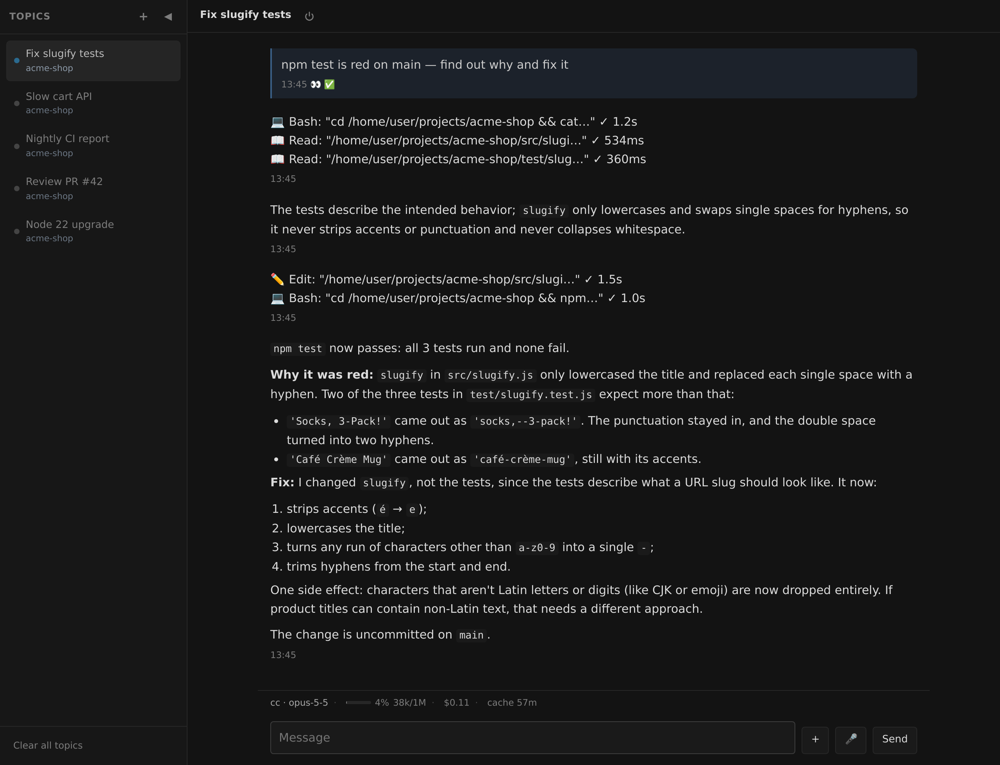

# Web UI

English | [简体中文](zh-CN/web-ui.md)



A plain dark chat page the daemon serves itself. No bot to register, no account,
no upstream service — it is the fastest way to have a working gateway, and the
only one that works with no chat platform at all.

```yaml
platforms:
  web:
    type: webui
    token: ${WEB_TOKEN}       # required: the shared secret the login page asks for
    host: 0.0.0.0             # default; 127.0.0.1 to keep it to an SSH tunnel
    port: 8787                # default
    title: Chat               # default; the browser tab's title

access:
  allowFrom: ["web:owner"]    # the identity is always <instance id>:owner
```

Open `http://<host>:8787`, enter the token, and you have the same conversation
every other platform gets: streaming replies, tool bubbles, the `/model`, `/effort`
and `/cd` button menus, `ask` questions, file upload and download. Menus are
laid out as a grid with the current choice lit, and hold 24 to a page where chat apps hold 12.
`/setting` is a page of its own rather than a message in the transcript: **All settings** in the
**⚙ Menu** at the foot of the topic list opens it, and typing `/setting` does the same.
It is one column of sections, and each setting is changed in place with the control that fits it: a
switch for on/off, a segmented control or a dropdown for a short list, and a row per agent for the
default models, each showing its whole model id and opening that agent's list — any agent's, running
or not — with a field that filters it and takes a name it does not have. A banner says what
each change did, or why it was refused. The bar says these are saved to config.yaml for every topic
— none of them is the topic's own — and the agent answering the topic you opened it from is marked
*this topic*; switching topics puts the page away. What you type stays in the transcript as your
message — the page does not. See [settings](settings.md).

**Switching the model.** The line above the composer names the agent and its model, and the model
is a button: it opens the models the topic's agent offers, the one in use ticked and the agent's
default marked, with a filter when the list is long. A tap switches this topic only — the same as
typing `/model <id>`, so a typed `/model` afterwards says the same — and config.yaml is not
touched; each agent's default is in **All settings**. An agent with no session yet is started to
ask (a second or two, said while it happens); a harness that offers no model choice says so.

**Topics.** The sidebar on the left lists parallel conversations and switches between them,
the same way a Telegram forum topic or a Feishu 话题 does: each has its own agent
session and its own context, and each gets named automatically from what it turned
out to be about. A title opens with the agent that answers it in brackets — just the id, since
the machine is named on the line below — and hovering the title shows the whole name. `+` opens
one; the agent can open one itself with
`talkcode create-thread`, and write into one with `--channel main/<topic id>`. Under each
title is the directory the topic works in, led by the machine when its agent runs on a
[remote host](remote-hosts.md) (`devbox · talkcode`); hover it for the full path. Drag its right
edge to make it wider or narrower — the width is kept in this browser — and double-click the edge
for the default. On a narrow screen it becomes a drawer. The × in its header closes it at any
width, and the same × closes the task panel on the right: the two are one component, with the
same header and footer rows, the same slide and the same dimmed backdrop.

**Choosing an agent.** With more than one agent configured, a new topic opens on all of them,
grouped by machine: each card shows the agent's id, what it is (Claude Code, Codex, OpenCode,
Antigravity, or a custom agent's command) and its model if one is set. Tap one and it answers
this topic; the directory menu then asks where it should work, as a bare `/cc` does. Or just
type — the card marked **default** is the agent that answers. The cards go away as soon as
anything is said in the topic.

**Stopping it.** While a reply is streaming, **Stop** beside Send ends the turn
(`/stop`) — and the same goes for an agent reporting back on background work after
its turn ended, which the topic shows as running too. While an agent process is up
behind the topic, the power button beside its title ends the process (`/kill`) — the
conversation is kept, and the next message picks up where it left off. Both simply
send the command, so a draft in the composer is left where it is.

**Closing idle agents.** An agent process stays up after its turn until the daemon's idle
timeout reclaims it (the dim blue dot). **Close idle (N)** in the **Manage** menu at the bottom
of the topic list ends all of them at once: it lists the topics it is about to close, asks, and
then says which were closed. The count is on Manage's own face, so you see it without opening
anything. Each conversation is kept, and the next message in a topic starts its agent again where
it left off. A topic that starts working in the meantime is left running, and starred topics are
closed like the rest. **Clear all topics** is in the same menu.

**Scheduled tasks.** The clock at the right of the chat header opens a panel with two tabs at its
foot. **Sessions** lists the topics a new-session run opened; those topics are kept out of the topic
list, so this is where they live, and tapping one opens it (the × deletes it). **Tasks** lists every
task the gateway has registered — what it runs, when it runs next, where its output goes, and how the
last run ended.
A run waiting on an answer puts an amber dot on the clock itself, since it has no row in the topic
list to show it.
The panel is a column of its own on a wide screen. It is the same component as the topic sidebar
on the other edge — same header and footer rows, same ×, same slide and backdrop — and only its
default width and the width at which it stops being a column differ. Below 1024px it is a drawer
that slides in from the right, at most 88% of the screen wide, with a strip of the chat still
visible; below 640px the topic sidebar is that same drawer on the left. The dimmed chat behind it
is what closes it. It is closed by default, and only a docked panel is restored on a reload; on a
narrow screen it opens from the clock each time. Opening a session leaves a docked panel where it
is. It is narrower than the topic sidebar — drag its left edge to resize it, double-click the edge
for the default width. Tap a task for the
full prompt or command, pause or resume it, run it now, or delete it (two taps). Tasks are still
registered by asking an agent in a topic — the panel manages them, it does not create them.

**What needs you.** Every topic waiting on you moves to the top of the list, its title in green,
with a line under the group: a question to answer first (amber dot), then a turn that failed (red
dot), then a reply you have not read yet (green dot). Hover a row for what it is — a reply's first
line, which is usually the conclusion. A reply goes back to its place once you have looked at it. A
failure stays until the next turn runs, and its dot stays red after that.

A sub-agent's topic is not one of these: its finished replies and failures are the news of the
agent that opened it, so it is never moved up, and its finished turn keeps the ordinary idle/online
dot instead of the green one. Its questions (amber) and its work (blue) are unchanged, and the
topic that started it is what turns green when the answer is waiting for you.

Below that group the list is ordered by what each topic is doing: working, then an agent that is up
with nothing to do, then one with no process behind it. The directory menu a new topic shows after
you pick its agent is not one of these: it is a control for your own next step rather than
something an agent is blocked on, so a topic you leave half set up keeps its place and sends no
notification.
[Sub-agent](sub-agents.md) topics are folded under the topic that opened
them — tap the count to open them — and a topic whose sub-agents are still working is shown as
working itself, even between its own turns. They move up only for a question of their own — the
agent that opened them reads the rest. A link to a topic in a
reply opens it in place.

**Low attention.** With several agents working at once the list keeps moving: every running
topic's dot pulses, and its unread count climbs in a bright blue pill with each message. Turn on
**Low attention** in the **⚙ Menu** at the bottom of the topic list and that stops: a running
topic's dot stays bright blue but holds still, and unread counts turn grey. A question waiting on
you (its amber dot still pulses), a failed turn and a reply you have not read still move to the
top in green, so they are the only things that stand out. The setting is kept in this browser
only. **All settings** (the page above), Notifications and **Skills** are in the same menu;
**Close idle** and **Clear all topics** are in **Manage** beside it.

**Tool calls, in full.** Each tool the agent runs is one row in its tool bubble, and here
a row carries the whole command — up to 2000 characters — where a chat app gets the
first 40 (`tools.previewLimit`). The row is cut at the edge of the bubble, so a wide
screen shows as much as fits, and the ✓ and duration at its end always stay visible.
Click a row to read it in full, and again to fold it; **Show all** under the bubble
opens every row, including the ones the agent adds after you press it.

**Pictures.** Paste a screenshot (Ctrl-V) or attach one and it shows as a thumbnail in the
composer, with an × to take it back off the message. Once sent, your message shows it too, and a
tap fills the screen with it. The daemon keeps that copy only while it is running: after a
restart, a message from before it keeps the picture's name but not the picture.

**Reading a file without downloading it.** When the agent sends a Markdown file, a log, a
CSV or a source file, click its name and it opens in a window over the conversation; **Download**
beside the name saves it as before. Markdown is rendered like a reply, with headings, tables and
code blocks; anything else is shown as plain text. An `.html` or `.svg` file is shown as its source
and is never run. A file over 512 KB shows its first 512 KB and says so, and the **Download** link
in the window's bar fetches the whole file. PDFs, office documents and other binary files have no
preview and stay downloads. Like the download link, preview works only until the daemon restarts;
a message from before a restart keeps the plain download link.

**Built for a bad connection.** Replies are sent when they settle rather than on
every keystroke of the stream, everything on the wire is compressed, and a dropped
connection resumes from where it left off instead of re-downloading the
conversation. In a 30-second streamed answer that is 13 updates collapsed to 3, at
about a quarter of the bytes. Sends carry a nonce, so the page retries safely on a
link that drops them. A send that gets no answer at all does not stay grey: after 15
seconds (longer for a big attachment, up to 5 minutes) it turns red with **Retry**,
**Copy** and **Discard**. A message that is still grey after that has not left the
browser.

**Nothing you typed is lost to a dropped connection.** A message is written down in the
browser the moment you send it and kept until the daemon has it, so a reload — including
the one an expired Cloudflare Access session forces on you — brings it back under the
conversation instead of losing it. If the page went away before the daemon answered, the
message says it is not confirmed until the page has checked; if the daemon never got it,
it turns red with **Retry**. Retry after a reload works for text; a message that carried
files offers **Copy** and **Discard**, because the files themselves are not kept. The
composer's draft is saved too, a second after you stop typing.

## Skills

**Skills** in the **⚙ Menu** at the bottom of the topic list opens the gateway's managed skills — the ones every
agent is given (see [Skills the gateway keeps](skills.md)). The page lists each skill with its
status (active, expired or archived), whether it is pinned and when it was last used. **New**
creates one; opening a skill shows its files, a `SKILL.md` editor and every recorded change, and
**Delete** archives it rather than removing it — **Restore** brings it back. Saving `SKILL.md`
carries the version the page read, so an edit made elsewhere is refused instead of overwritten.
The page writes through the same store as `talkcode skills`, and an archive made here still tells
the conversation that created the skill.

## Notifications

**Notifications** in the **⚙ Menu** at the bottom of the topic list turns on push notifications
for this device. The browser asks for permission once. After that the device is notified even when the
page is closed or the phone is locked. Tapping a notification opens the topic.

What notifies: any topic that starts needing you — for a sub-agent's topic, only a question of its
own. A topic you are reading when it happens does not notify. Turn it on in each browser where you want notifications, and off the same way.

- Chrome, Edge and Firefox on desktop and Android. On iPhone and iPad, only after **Add to Home
  Screen** (iOS 16.4 or later), opened from the home-screen icon.
- The page has to be served over HTTPS (or from `localhost`). A plain `http://` address on the
  network cannot ask for notifications.
- Notifications go through the browser maker's push service (Google, Mozilla or Apple). The
  gateway needs to reach it over HTTPS. The content is encrypted for your device, and is only the
  topic's name and one line.
- The key and the devices are kept in `~/.config/talkcode/webui-push-<instance>/`. Deleting the
  directory forgets every device, and each one has to turn notifications on again.

## Terminal

Turned on, the chat header grows a `>_` button that
opens a real shell on the machine the daemon runs on — so you can drive *any*
coding-agent CLI, TUI and all, from the same page. It is a window per topic, and
its two buttons mean different things: minimize hides it while everything keeps
running and stays attached, close ends the session for good. The topic list marks
which topics have a terminal open. The daemon does not implement a terminal: it
proxies, behind the same login, to a
[`ttyd`](https://github.com/tsl0922/ttyd) you run on a unix socket. Off unless you
ask for it.

```yaml
platforms:
  web:
    type: webui
    token: ${WEB_TOKEN}
    terminal:
      enabled: true
      socket: ~/.config/talkcode/webui-term-web.sock   # where your ttyd listens
      # Optional: how to END a session. Without it the window has no close button,
      # only minimize — because what holds a session open on the far side is your
      # arrangement, not this daemon's. argv, never a shell string.
      endCommand: ["tmux", "-L", "aa-web", "kill-session", "-t", "aa-{topic}"]
```

```bash
# The other half, which is not this package's job to run. The wrapper should put the
# session in tmux — otherwise closing the tab kills whatever was running in it.
printf '#!/bin/sh\nexec tmux -L aa-web new -A -s "aa-$1"\n' > /usr/local/bin/aa-terminal.sh
chmod +x /usr/local/bin/aa-terminal.sh
ttyd -i ~/.config/talkcode/webui-term-web.sock -b /term -W -a -O \
     -T xterm-256color /usr/local/bin/aa-terminal.sh
```

## Exposing it

> [!WARNING]
> The default binds every interface and speaks plain HTTP, so the token is the
> only thing between your network and an agent with full tool access. Put a
> reverse proxy with TLS in front of it before exposing it beyond a network you
> control, or set `host: 127.0.0.1` and reach it over an SSH tunnel.
> If you do proxy it, turn response buffering **off** (`proxy_buffering off;` in
> nginx) — buffered server-sent events show nothing until the turn ends, and pass
> `Upgrade`/`Connection` through if you enable the terminal.
> Enabling the terminal moves that token from guarding *a conversation with an
> agent* to guarding *a shell*. Same ceiling, much shorter path.

## Single sign-on

When a token is not enough. One shared secret has no name on
it, never expires, and cannot be revoked for one person. If the page already sits
behind an identity-aware proxy — Cloudflare Access, Teleport's Application
Service — that proxy has authenticated a *person*, with SSO and MFA, and says so
in a JWT it signed. Point `sso:` at the proxy's public keys and the daemon checks
that signature instead of asking for a password a second time.

```yaml
platforms:
  web:
    type: webui
    token: ${WEB_TOKEN}
    sso:
      # Cloudflare Access. For Teleport: header Teleport-Jwt-Assertion,
      # jwksUrl https://<proxy>/.well-known/jwks.json, claim username.
      header: Cf-Access-Jwt-Assertion          # default
      cookie: CF_Authorization                 # the WebSocket handshake's copy
      jwksUrl: https://<team>.cloudflareaccess.com/cdn-cgi/access/certs
      issuer: https://<team>.cloudflareaccess.com
      audience: <the application's AUD tag>    # NOT optional: it is what stops a
                                               # token for another app of the same
                                               # provider from opening this one
      claim: email                             # default
      allow: ["you@example.com"]
      from: ["172.24.0.0/16"]                  # the proxy, and nothing else
      password: false                          # once sso works, close the old door
```

`from` is required, and is the reason a forged header is not interesting even if
something above it is misconfigured: the signature makes forgery useless, and
`from` makes a mistake in the four fields above it survivable. A refusal logs the
address it came from, which is how you find what to put there. `talkcode
doctor` fetches the JWKS and reports how many keys it found — do that before
setting `password: false`, because with the password door shut a provider outage
means nobody opens the page at all.

## What to expect

Everyone who knows the token shares the same topics. A daemon restart does not lose what was said
in them: the daemon writes each topic's transcript to its own disk within a few seconds of any
change, and the agent's session is on disk too. So after a restart or a container rebuild every
topic comes back, in every browser, with everything that was said in it — including a reply that
finished after you put your phone down. The messages from before sit above a divider saying so,
and the agent carries on below them with its context intact. (Before 2.13.0 only starred topics
were kept this way; an unstarred topic from then shows what your browser had of it, or nothing.)
A **starred** topic (☆ in the sidebar) is never removed to make room for a new one, and "Clear
unstarred topics" leaves it alone.
