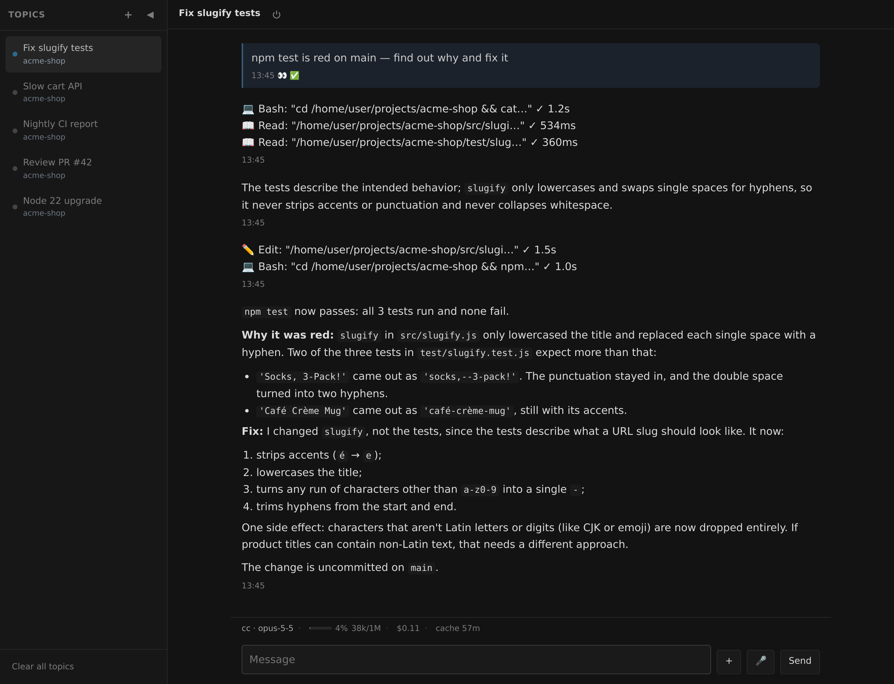

# 网页端

[English](../web-ui.md) | 简体中文



守护进程自己提供的一个朴素深色聊天页。不用注册机器人、不用账号、不依赖任何外部
服务——这是把网关跑起来最快的方式，也是唯一一个完全不需要聊天平台的入口。

```yaml
platforms:
  web:
    type: webui
    token: ${WEB_TOKEN}       # 必填：登录页要输的共享密钥
    host: 0.0.0.0             # 默认；想只走 SSH 隧道就填 127.0.0.1
    port: 8787                # 默认
    title: Chat               # 默认；浏览器标签页标题

access:
  allowFrom: ["web:owner"]    # 身份恒为 <实例 id>:owner
```

打开 `http://<host>:8787`，输入密钥，就得到和其他平台一样的会话：流式回复、工具
气泡、`/model` `/effort` `/cd` `/setting` 按钮菜单、`ask` 提问、附件上传与下载。菜单排成
网格、当前选项高亮，一页放 24 个（聊天平台是 12 个）。

**话题。** 左侧边栏列出并行的会话、在它们之间切换，和 Telegram 的论坛话题、飞书的话题群是同一种
形状：每个话题有自己的 agent session、自己的上下文，并且会根据聊下来的内容被自动命名。
点 `+` 新建；agent 自己也可以用 `talkcode create-thread` 开一个，用
`--channel main/<话题 id>` 往指定话题里写。每个标题下面是这个话题的工作目录；智能体跑在
[远程主机](remote-hosts.md)上时前面还会带上机器名（`devbox · talkcode`），鼠标悬停能看到完整路径。
窄屏上侧边栏会变成抽屉。

**停下来。** 回复正在流式输出时，Send 旁边的 **Stop** 结束这一轮（`/stop`）；一轮结束后智能体因为后台任务
完成而回来继续干活时，话题同样显示为运行中，Stop 也能把它停下。话题背后有
智能体进程在跑时，标题旁的电源按钮结束这个进程（`/kill`）—— 会话保留，下一条消息接着原来的
继续。两个按钮都只是替你发出对应命令，输入框里写了一半的草稿不受影响。

**完整的工具命令。** 智能体跑的每个工具在工具气泡里占一行。聊天应用里一行只带命令的前 40 个
字符（`tools.previewLimit`），这里带整条命令（最多 2000 个字符）。行在气泡边缘处截断，屏幕宽
就多显示一些；行尾的 ✓ 和耗时始终看得见。点一行展开全文，再点一次收起；气泡下方的
**Show all** 展开所有行，按下之后智能体新加的行也是展开的。

**图片。** 粘贴截图（Ctrl-V）或者选一张图片附上，输入框里会显示缩略图，带一个 × 可以从这条消息里
拿掉。发出去之后，你的消息里也显示这张图，点一下全屏查看。守护进程只在运行期间保留这份副本：重启
之后，重启前的消息只留下图片的文件名，不再显示图片。

**不用下载就能看文件。** 智能体发来 Markdown、日志、CSV 或源代码文件时，文件名旁边有个
**Preview** 按钮，点开就在对话上方直接阅读。Markdown 按回复的样式渲染，标题、表格、代码块都在；
其他文件按纯文本原样显示。`.html` 和 `.svg` 只显示源码，绝不会运行。超过 512 KB 的文件只显示前
512 KB 并注明，阅读栏里的 **Download** 链接可以下载完整文件。PDF、Office 文档和其他二进制文件
没有预览，仍然只能下载。和下载链接一样，预览只在守护进程这次运行期间有效；重启之前的消息不再
提供预览。

**为弱网写的。** 回复是在内容稳定后才发，而不是流式的每一次刷新都发；线路上的东西全部压缩；
断线重连从断点续传，而不是重新下载整个会话。一次 30 秒的流式回答，13 次更新被压成 3 次，
字节数大约是原来的四分之一。发送带 nonce，所以页面可以放心重试。一次发送如果完全没有回应，
消息不会一直灰着：15 秒后（带大附件时更长，最多 5 分钟）它会变红，并给出 **Retry**、
**Copy**、**Discard**。超过这个时间还是灰色的，就说明这条消息没有离开浏览器。

**断线不会弄丢你打的字。** 消息在你点发送的那一刻就记在浏览器里，直到守护进程确认收到才删掉。
所以刷新页面——包括 Cloudflare Access 会话过期后不得不做的那次刷新——之后它还在，排在对话最下面，
不会丢。如果页面在守护进程回话之前就关了，这条消息会标明「未确认」，等页面核对过再说；确认守护进程
没收到，它就变红并给出 **Retry**。刷新后的 Retry 只对纯文本有效；带了文件的消息只给 **Copy** 和
**Discard**，因为文件本身没有保存下来。输入框里的草稿也会在你停止打字一秒后保存。

## 终端

打开之后，聊天页顶栏会多一个 `>_` 按钮，在聊天记录之上开出一个守护
进程所在机器的真终端——于是**任何** coding agent 的 CLI，连同它的 TUI，都能在同一个页面里
直接跑。它是**每个话题一个窗口**，右上角两个按钮是两件不同的事：最小化只是收起来，里面
跑着的东西照常跑、连接也不断；关闭才是真的结束这个会话。话题列表会标出哪些话题开着终端。
守护进程自己不实现终端：它只是把请求过同一道登录门之后，转发给你自己跑在 unix
socket 上的 [`ttyd`](https://github.com/tsl0922/ttyd)。默认关闭，要自己打开。

```yaml
platforms:
  web:
    type: webui
    token: ${WEB_TOKEN}
    terminal:
      enabled: true
      socket: ~/.config/talkcode/webui-term-web.sock   # 你的 ttyd 监听在哪
      # 可选：怎么「结束一个会话」。不配的话窗口上就没有关闭按钮，只有最小化——
      # 因为会话能在断线之后活下来是你那边的安排，不是这个守护进程的。
      # 是 argv 数组，不是 shell 字符串。
      endCommand: ["tmux", "-L", "aa-web", "kill-session", "-t", "aa-{topic}"]
```

```bash
# 另一半不归这个包管。wrapper 里要套一层 tmux——否则关掉标签页，
# 里面正在跑的东西会跟着被 SIGHUP 掉。
printf '#!/bin/sh\nexec tmux -L aa-web new -A -s "aa-$1"\n' > /usr/local/bin/aa-terminal.sh
chmod +x /usr/local/bin/aa-terminal.sh
ttyd -i ~/.config/talkcode/webui-term-web.sock -b /term -W -a -O \
     -T xterm-256color /usr/local/bin/aa-terminal.sh
```

## 对外暴露

> [!WARNING]
> 默认监听所有网卡且是明文 HTTP，所以那个密钥就是你的网络和一个拥有完整工具权限的
> 智能体之间的全部屏障。要暴露到你掌控范围之外，先在前面加一层带 TLS 的反向代理；
> 或者设 `host: 127.0.0.1`，用 SSH 隧道访问。
> 如果确实过反代，务必**关掉响应缓冲**（nginx 里 `proxy_buffering off;`）——被缓冲的
> SSE 会让整轮回复到结束才一次性出现；开了终端的话还要放行 `Upgrade`/`Connection`。
> 另外：打开终端，等于把这个密钥从「守着一条和智能体的对话」变成「守着一个 shell」。
> 权限上限没变，但从密钥泄漏到任意命令的距离短了很多。

## 单点登录

一个共享密钥不够用的时候。共享密钥上没有名字、不会过期，也没法只
吊销某一个人。如果这个页面前面已经有一层认证代理——Cloudflare Access、Teleport 的
Application Service——那它已经认过「人」了（SSO + MFA），并把结论签成一个 JWT 带
过来。把 `sso:` 指向这个代理的公钥，守护进程就去验这个签名，而不是再问一遍密码。

```yaml
platforms:
  web:
    type: webui
    token: ${WEB_TOKEN}
    sso:
      # 这里是 Cloudflare Access。Teleport 换成：header Teleport-Jwt-Assertion、
      # jwksUrl https://<proxy>/.well-known/jwks.json、claim username。
      header: Cf-Access-Jwt-Assertion          # 默认值
      cookie: CF_Authorization                 # WebSocket 握手拿不到 header 时的那份
      jwksUrl: https://<team>.cloudflareaccess.com/cdn-cgi/access/certs
      issuer: https://<team>.cloudflareaccess.com
      audience: <这个应用的 AUD tag>           # 不是可选项：它挡住的是「同一个 IdP
                                               # 给另一个应用签的 token」
      claim: email                             # 默认值
      allow: ["you@example.com"]
      from: ["172.24.0.0/16"]                  # 只有代理，别的都不行
      password: false                          # SSO 跑通之后，把老门关掉
```

`from` 是必填的：签名本身已经让伪造请求头没有意义，`from` 保的是上面四个字段里写
错一个也不至于致命。被拒的请求会把来源地址打进日志——那行就是你该往 `from` 里填
什么的答案。`talkcode doctor` 会去拉一次 JWKS 并报告拿到几把钥匙，**在设
`password: false` 之前先跑一次**：老门关掉之后，IdP 一挂就没人打得开这个页面了。

## 要有的预期

知道密钥的人共用同一批话题。守护进程重启不会丢掉话题里说过的话：任何话题一有变化，几秒之内守护进程就
把聊天记录写到自己的磁盘上，智能体的会话也存在磁盘上。所以重启或重建容器之后，每个话题在任何浏览器里
都会带着全部内容回来——包括你放下手机之后才答完的回复。重启前的消息在一条分隔线上方，分隔线注明它们来自
重启之前，智能体带着上下文在下面接着干。（2.13.0 之前只有星标话题这样保存；那时没加星的话题，只能显示你
的浏览器自己存下的部分，或者什么都没有。）**星标**话题（侧边栏里的 ☆）不会为了腾位置被删掉，「Clear
unstarred topics」也不会动它。
